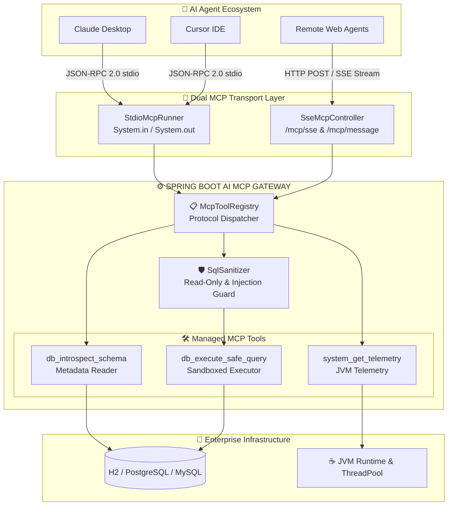

<div align="center">

# 🌐 Spring Boot AI MCP Gateway
### Enterprise Model Context Protocol (MCP) Server in Java 17 & Spring Boot 3

[](https://www.oracle.com/java/)
[](https://spring.io/projects/spring-boot)
[](https://modelcontextprotocol.io/)
[](https://github.com/frankitoromas-tech/spring-boot-ai-mcp-gateway/actions)
[](https://opensource.org/licenses/MIT)
[](https://github.com/frankitoromas-tech)

<p align="center">
  <b>Production-ready Enterprise MCP Gateway exposing safe database schema introspection, parameterized read-only queries, and JVM telemetry to AI Agents (Claude Desktop, Cursor, OpenAI Agents, LangChain) via Dual stdio and SSE Transports.</b>
</p>

</div>

---

## 🏛️ Enterprise Architecture



---

## 🛠️ Exposed MCP Tools

| Tool Name | Parameters | Purpose | Security Guarantee |
| :--- | :--- | :--- | :--- |
| `db_introspect_schema` | `table_pattern` *(string, optional)* | Discovers database tables, column names, SQL data types, nullability, and primary keys. | Pure JDBC metadata query; zero arbitrary SQL execution. |
| `db_execute_safe_query` | `query` *(string, required)* | Executes business intelligence queries against target relational databases. | Hard-enforced read-only (`SELECT`, `WITH`), stacked query blocking, hard 5s timeout, and auto `LIMIT 100`. |
| `system_get_telemetry` | *(none)* | Inspects heap memory utilization, active thread count, and system uptime. | Read-only JVM MXBean telemetry. |

---

## 🔒 Enterprise Security Guardrails

Autonomous agents cannot be trusted with raw database access. `spring-boot-ai-mcp-gateway` implements defensive guardrails at the application boundary:

1. **Strictly Read-Only Queries:** All statements must match `^(SELECT|WITH|EXPLAIN)`.
2. **Stacked Injection Defense:** Rejects semicolons followed by non-whitespace (blocks `; DROP TABLE`, `; UPDATE`).
3. **Keyword Blacklist:** Actively scans and blocks `DROP`, `ALTER`, `TRUNCATE`, `DELETE`, `UPDATE`, `INSERT`, `MERGE`, `EXEC`, `CALL`, `GRANT`, `REVOKE`, `SHUTDOWN`.
4. **Memory Exhaustion Prevention:** Queries without a `LIMIT` clause automatically have `LIMIT 100` appended.
5. **Execution Timeout:** Statements are governed by a strict JDBC timeout (`Statement.setQueryTimeout(5)`) to eliminate denial-of-service hanging queries.

---

## 🚀 Getting Started

### 1. Build and Run

```bash
# Clone the repository
git clone https://github.com/frankitoromas-tech/spring-boot-ai-mcp-gateway.git
cd spring-boot-ai-mcp-gateway

# Build and run with Maven
mvn clean spring-boot:run
```

The gateway starts on `http://localhost:8080` with sample database records pre-seeded.

---

## 🔌 Integration with AI Clients

### Anthropic Claude Desktop (`claude_desktop_config.json`)

To enable Claude Desktop to directly introspect your database and query metrics:

```json
{
  "mcpServers": {
    "spring-database-gateway": {
      "command": "java",
      "args": [
        "-Dspring.main.banner-mode=off",
        "-Dmcp.transport.stdio-enabled=true",
        "-jar",
        "/path/to/spring-boot-ai-mcp-gateway/target/spring-boot-ai-mcp-gateway-1.0.0.jar"
      ]
    }
  }
}
```

### Remote Network Agent via SSE (Curl Example)

```bash
# 1. Connect to SSE stream
curl -N http://localhost:8080/mcp/sse

# 2. Invoke tool via JSON-RPC POST
curl -X POST http://localhost:8080/mcp/message \
  -H "Content-Type: application/json" \
  -d '{
    "jsonrpc": "2.0",
    "id": 1,
    "method": "tools/call",
    "params": {
      "name": "db_execute_safe_query",
      "arguments": {
        "query": "SELECT name, budget FROM departments ORDER BY budget DESC"
      }
    }
  }'
```

---

## 🧪 Testing & Verification

Run the comprehensive unit and integration test suite:

```bash
mvn clean test
```

Includes:
- `SqlSanitizerTest`: Asserts injection defense, read-only validation, and LIMIT enforcement.
- `McpGatewayApplicationTests`: End-to-end Spring Boot context tests verifying tool registration, JSON-RPC schema responses, database querying, and JVM telemetry.

---

## 👨‍💻 Author & Attribution

- **Developer:** Frank Emiliano Vargas Huamán ([@frankitoromas-tech](https://github.com/frankitoromas-tech))
- **Signature / Brand:** `Frankosyni (Φρανκοσύνη/Francus.)` 🔥
- **Specialty:** Software & Agentic AI Developer | Backend Java Enterprise

---

## 📄 License

This project is licensed under the [MIT License](LICENSE).
